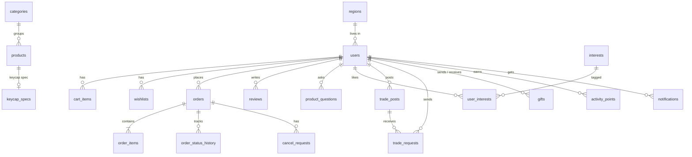

# DB 스키마

> 지금 DB에 **실제로 있는 테이블**만 적습니다 (기준: `backend/app/models/`, 마이그레이션 head `3c1d9a7e5b20`).
> 컬럼 이름은 snake_case, 모든 시간은 `timestamptz`. 새 테이블을 만들면 이 문서도 같이 고쳐 주세요.
> 데스크 꾸미기·토너먼트 테이블은 범위에서 빠져 만들지 않았습니다.

## 전체 관계도

---

## 계정 · 상품
| 테이블 | 주요 컬럼 | 비고 |
| --- | --- | --- |
| **users** | id, email (unique), google_sub (unique), nickname (lower() unique), avatar_url, created_at | PIXEL LOCAL 컬럼은 아래 |
| (users · PIXEL LOCAL) | region_code FK, fandom_opt_in, profile_public, map_avatar_opt_in, nickname_public, map_card_public (모두 bool, 기본 false) | 집계 참여 · 취향 공개 · 지도 아바타 · 닉네임 공개 · 이웃 카드 공개 |
| **categories** | slug PK, name (unique), description, sort_order | 6개 |
| **products** | id, name, price, category_slug FK, image_url, description, is_new, created_at | 180개 시드 |
| cart_items | user_id FK, product_id FK, quantity, added_at · PK(user_id, product_id) | 수량 1~99 |
| wishlists | user_id FK, product_id FK, created_at · PK(user_id, product_id) | 위시맵 인기 찜 집계에도 사용 |

## 주문 · CS · 호환성
| 테이블 | 주요 컬럼 | 비고 |
| --- | --- | --- |
| orders | id, user_id FK, status, total_price, recipient_name, address, created_at | status: `paid → preparing → shipping → delivered` / `cancel_requested → cancelled` |
| order_items | id, order_id FK, product_id FK, quantity, unit_price | 주문 시점 가격 |
| order_status_history | id, order_id FK, status, changed_at | 배송 타임라인 |
| cancel_requests | id, order_id FK, reason, status(`requested/approved/rejected`), created_at | |
| reviews | id, user_id FK, product_id FK, order_item_id FK, rating(1~5), content, created_at · unique(user_id, product_id) | 배송 완료 상품만 |
| product_questions | id, product_id FK, user_id FK, title, content, is_secret, answer, answered_at, created_at | 비밀글은 작성자만 열람 |
| faqs | id, category, question, answer, sort_order | 시드 |
| keyboards | id, maker, model, layout, stem, profile_support text[], esc_size, spacebar_size, has_arrow_cluster | Mock 8개 시드 |
| keycap_specs | product_id PK/FK, profile, stem, key_sizes text[] | 키캡 30개 시드 |

## PIXEL LOCAL
| 테이블 | 주요 컬럼 | 비고 |
| --- | --- | --- |
| regions | code PK, level(`sido/sigungu/zone`), parent_code FK, name | 시 › 구 › 동·생활권 (41개 시드) |
| interests | id, type, name, parent_id | 작품 등 텍스트 태그만 (53개 시드) |
| user_interests | user_id FK, interest_id FK · PK | |
| trade_posts | id, user_id FK, region_code FK, kind(`have/want/sell`), product_id FK?, interest_id FK?, item_name, condition, price?, trade_method, content, status(`open/done/hidden`), is_sample, created_at | 연락처·장소 기재 금지. 화면 표기 WANT = "WISH" |
| trade_requests | id, post_id FK, requester_id FK, offer_post_id FK?(SET NULL), status(`pending/accepted/declined/cancelled/completed`), created_at, decided_at, owner_received_at, requester_received_at | 교환 신청 → 수락 → 양쪽 "받았어요" → 완료 |
| gifts | sender_id·recipient_id FK, trade_post_id FK?(SET NULL), product_id, quantity 1~9, unit_price, message(100), status(`pending/accepted/declined`), order_id FK, created_at, responded_at | 위시 글에 보내는 선물 (가상 결제) |
| fandom_samples | region_code, interest_id, count · PK | 덕력지도 Cold Start 집계 (응답에 `isSample`) |
| wish_samples | region_code, product_id, count · PK | 위시맵 Cold Start 집계 (응답에 `isSample`) |
| (집계) | `region_code × interest_id` **사용자 수**(중복 제거), 상위 지역은 하위 합산 | 최소 인원 제한 없음 (1명부터 표시, 0명은 null) |

## 활동 · 알림
| 테이블 | 주요 컬럼 | 비고 |
| --- | --- | --- |
| activity_points | id, user_id FK, kind, ref_id, points, created_at · unique(user_id, kind, ref_id) | 활동 점수 기록 → 하트·레벨·코인 계산. 같은 일은 한 번, 반복 활동은 하루 상한 (`services/activity.py`) |
| notifications | id, user_id FK, kind, title, body, href, ref_key, created_at, read_at · unique(user_id, kind, ref_key) | 헤더 알림 종. 같은 일은 한 번만 (`services/notifications.py`) |
| (뱃지) | 테이블 없음 | 주문·리뷰·활동 점수·거래·선물 기록으로 19종 계산 (`services/badges.py`) |
